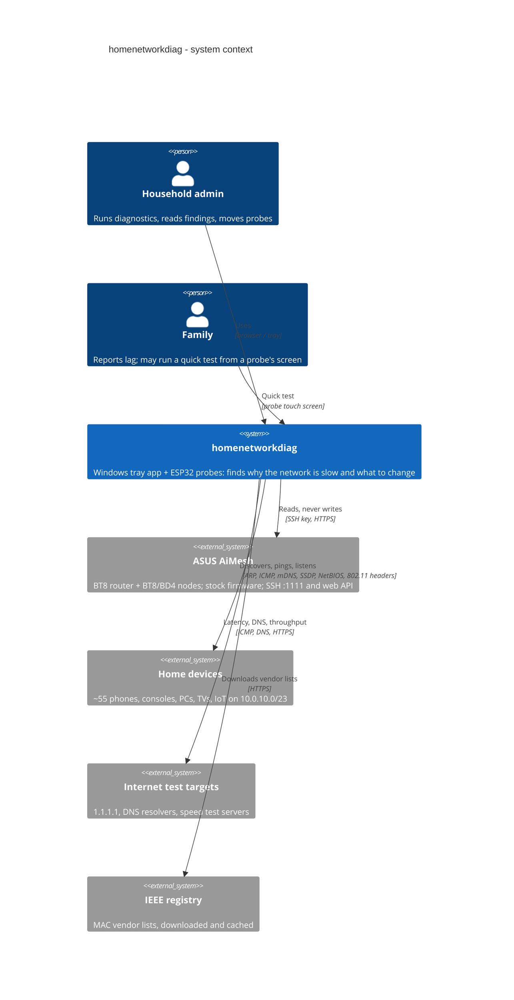
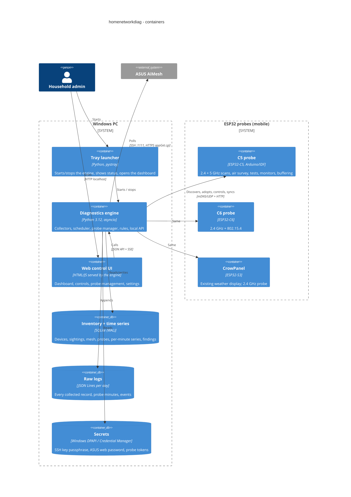
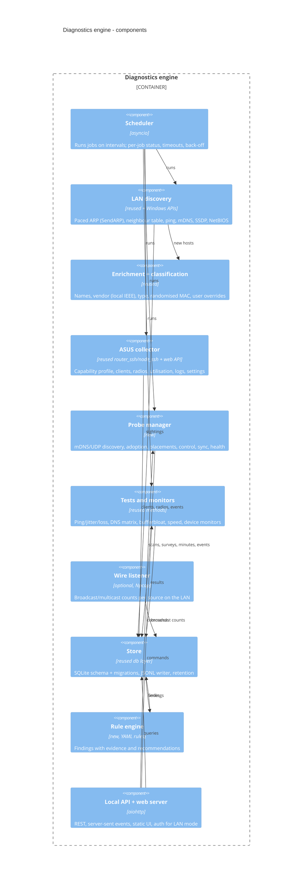
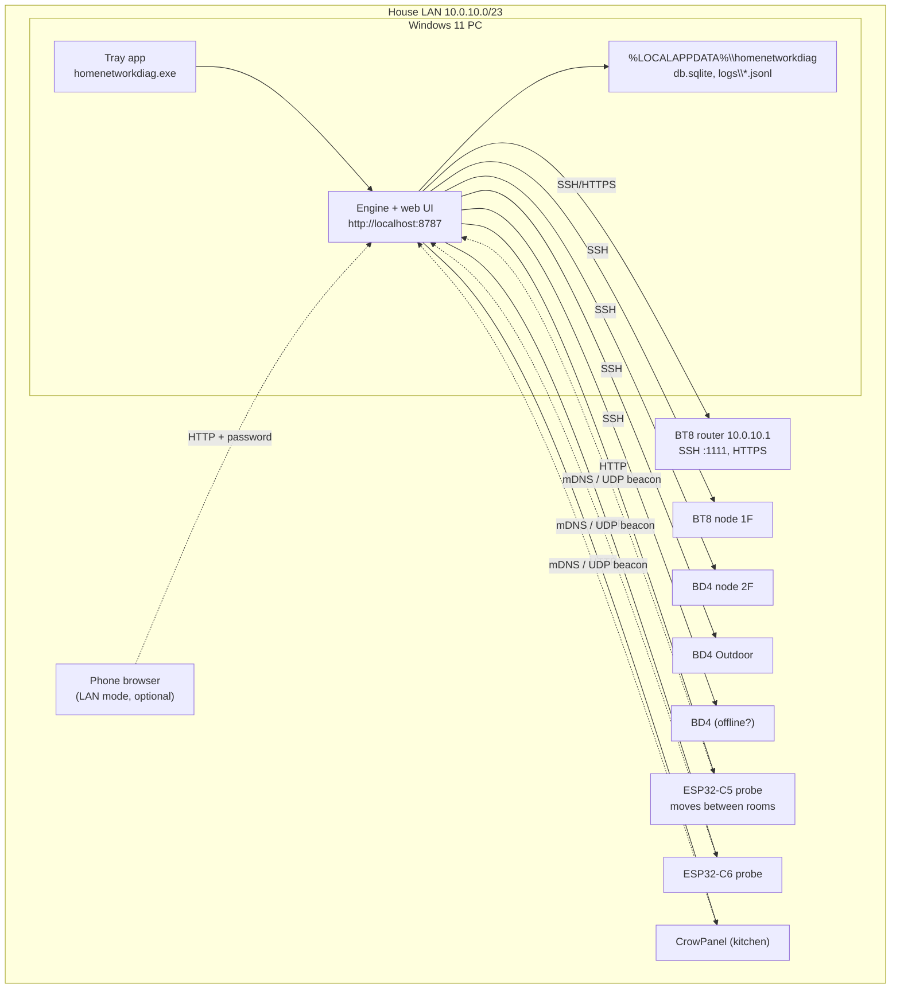
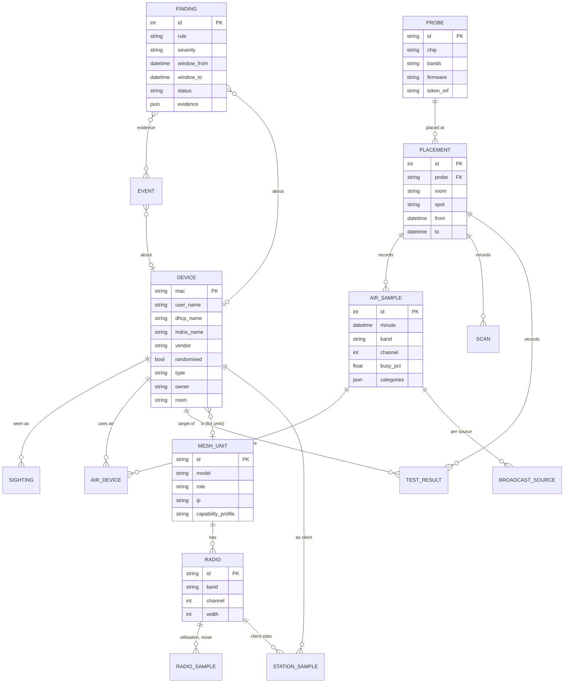

# Architecture

C4 diagrams (context, containers, components), deployment, data model and the main runtime flows. Mermaid diagrams render on GitHub. Decisions referenced as D-nn are in [decisions](10-decisions.md).

## 1. System context (C4 level 1)

## 2. Containers (C4 level 2)

## 3. Engine components (C4 level 3)

## 4. Deployment

## 5. Key design points

- **Tray app started when needed (D-02).** The engine runs only while the tray app runs. Probes therefore own long monitors: they keep measuring and buffering (RAM ring + SD card where fitted) while the PC is off, and the probe manager pulls everything since the last sync when the app starts. Records are idempotent (probe id + sequence number).
- **Web control interface (D-05).** Everything is done in the browser: dashboard, starting tests/surveys/monitors, adopting and placing probes, naming devices, settings. The tray menu offers: Open dashboard, Quick diagnosis, Pause collectors, Quit.
- **Probe auto-discovery (D-06).** See [probes](04-esp32-probes.md) and the sequence below.
- **Placements (D-07).** A probe's results are tagged with its current placement; history and comparisons are per placement (room), not per probe.
- **Read-only router (D-04), SSH key (D-09), capability detection (D-08).** See [ASUS data](05-asus-aimesh.md).
- **Do no harm (NFR-02).** Discovery is paced (for a /23: about 50 ARP requests/s, full sweep every 15 min), never continuous; the engine counts its own packets and shows them.
- **Time.** PC and probes use NTP; every record has UTC time plus local time for display.

## 6. Data model

## 7. Runtime flows

See [sequences and state machines](09-sequences.md).
