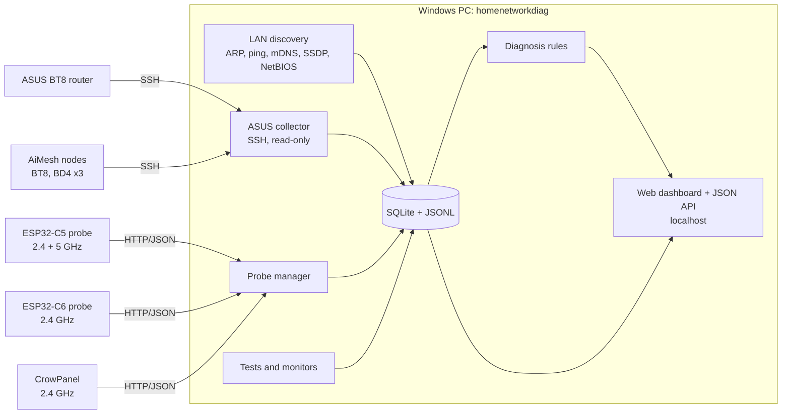

# Architecture (proposed)

This is a starting point for discussion; the choices marked **(decision)** are listed in [open questions](08-open-questions.md).

## Overview

## Components

### Windows application

- **Language (decision):** Python 3.12 is proposed, because most collectors already exist in Python in `homelab-unified` (ASUS SSH, discovery, enrichment, classification, SQLite layer). Packaged as a single folder / exe (PyInstaller) with an optional Windows service or tray icon. Alternative: .NET 8 (native Windows APIs, single binary) at the cost of rewriting the collectors.
- **Process model:** one long-running process with an asyncio scheduler; each collector is a job with its own interval, timeout and status.
- **Windows specifics:**
  - ARP resolution without admin rights via the `SendARP` Win32 API; ping via `IcmpSendEcho`; neighbour table via `GetIpNetTable2`.
  - Raw capture (broadcast counting on the wire, TST-06) via Npcap if installed; feature disabled with a clear message if not.
  - `nmap` optional (used if present on PATH), never required.

### Collectors

| Collector | Source | Default interval |
|---|---|---|
| LAN discovery | ARP sweep (paced), Windows neighbour table, mDNS browse, SSDP, NetBIOS | 15 min full sweep, neighbour table every 60 s |
| ASUS router | SSH read-only commands (see [ASUS data](05-asus-aimesh.md)) | 60 s clients/radios, 15 min config |
| ASUS nodes | SSH to each node from `cfg_device_list` | 60 s |
| Probes | Probe HTTP API (see [probes](04-esp32-probes.md)) | Push from probe, or poll 10-60 s |
| Tests | ICMP, DNS, HTTP download/upload | On demand and inside monitors |

### Probe protocol

- Probes expose an HTTP JSON API on the LAN (as the CrowPanel firmware does today: `/api/wifi.json`, `/api/air.json`, `POST /api/nettest`, `/logs`).
- Additions for probes: `GET /api/info` (capabilities, firmware, battery), `POST /api/air` with band/channel/duration, `POST /api/monitor`, streaming of results (decision: long-poll, WebSocket, or the probe POSTs to the PC).
- Discovery by mDNS (`_hndprobe._tcp`); authentication by a shared token set when the probe is adopted.
- Time is NTP-synced on probes so their records line up with the PC timeline.

### Storage

- **SQLite** (WAL mode, as in `homelab-unified`): devices, names/tags, sightings, mesh topology snapshots, findings, and down-sampled time series (per-minute).
- **JSON Lines** files per day for raw records (probe minutes, events, test results, router polls), so nothing is lost and everything is easy to analyse with `jq`, Python or pandas.
- Retention: raw 30 days, per-minute series 90 days, findings and device history kept.

### Diagnosis

- Rules (YAML) are evaluated over a time window against the stored series, e.g.
  `broadcast_flood: when probe.air.broadcastPct > 15 and top source share > 50% -> finding(severity=high, device=source)`.
- Each finding records the evidence (values, window, sources) so the dashboard can show "why".

### Dashboard

- Served on `http://localhost:<port>` (optionally on the LAN with a password). Static front end (no build step, or a small one) using the same visual language as the CrowPanel web dashboard.
- Pages: Overview, Devices, Mesh map, Radio, Tests, Monitor timeline, Findings, Probes, Settings, Help.

## Data model (first cut)

| Entity | Key fields |
|---|---|
| Device | mac (key), names (user, DHCP, mDNS, NetBIOS), vendor, randomised, type, owner, room, tags, first/last seen |
| Sighting | device, time, ip, source (arp/asus/probe/mdns...), node, band, rssi, rates |
| MeshUnit | id, model, role (router/node), MACs/BSSIDs per radio, backhaul, status |
| Radio | unit, band, channel, width, noise, tx power, clients |
| Probe | id, name, room, chip, bands, firmware, last seen |
| AirSample | probe, time, band, channel, busy%, categories, retries, devices, neighbours |
| AirDevice | sample, device, air%, bytes, rssi, rate |
| TestResult | type, origin (PC/probe), target, avg/max/jitter/loss, Mbps, time |
| Event | time, origin, type, device, details |
| Finding | rule, severity, window, evidence, recommendation, status |
