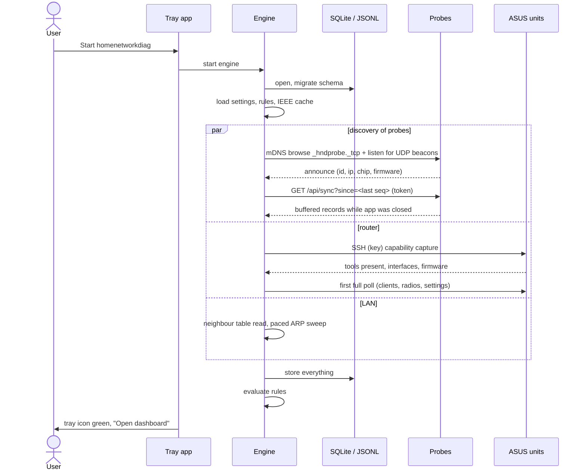
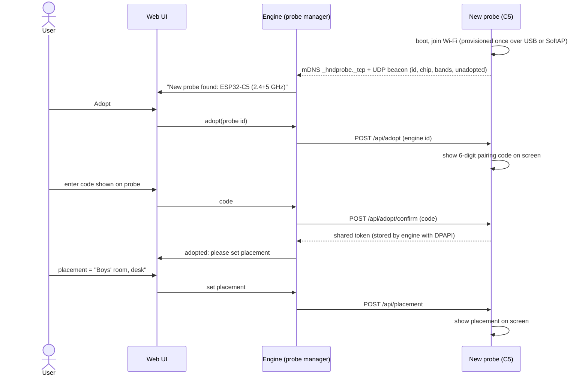
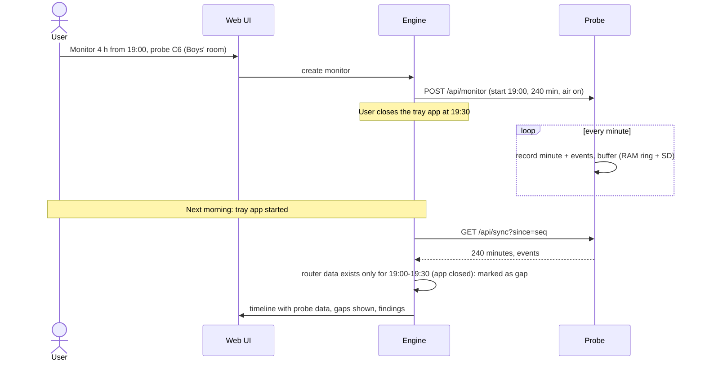
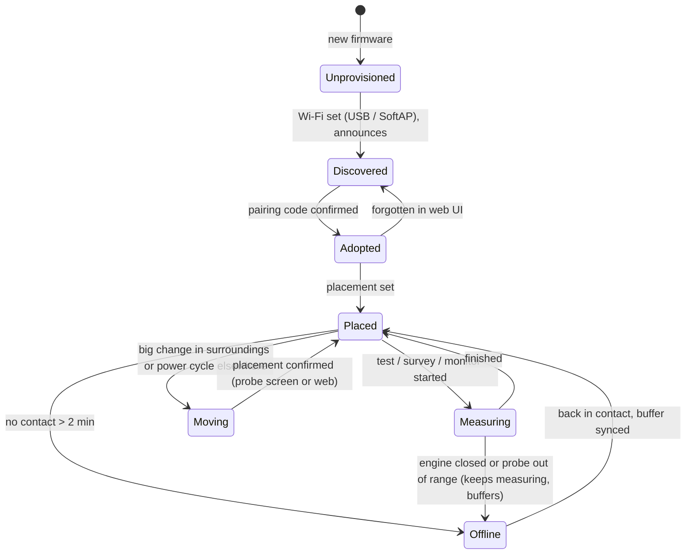
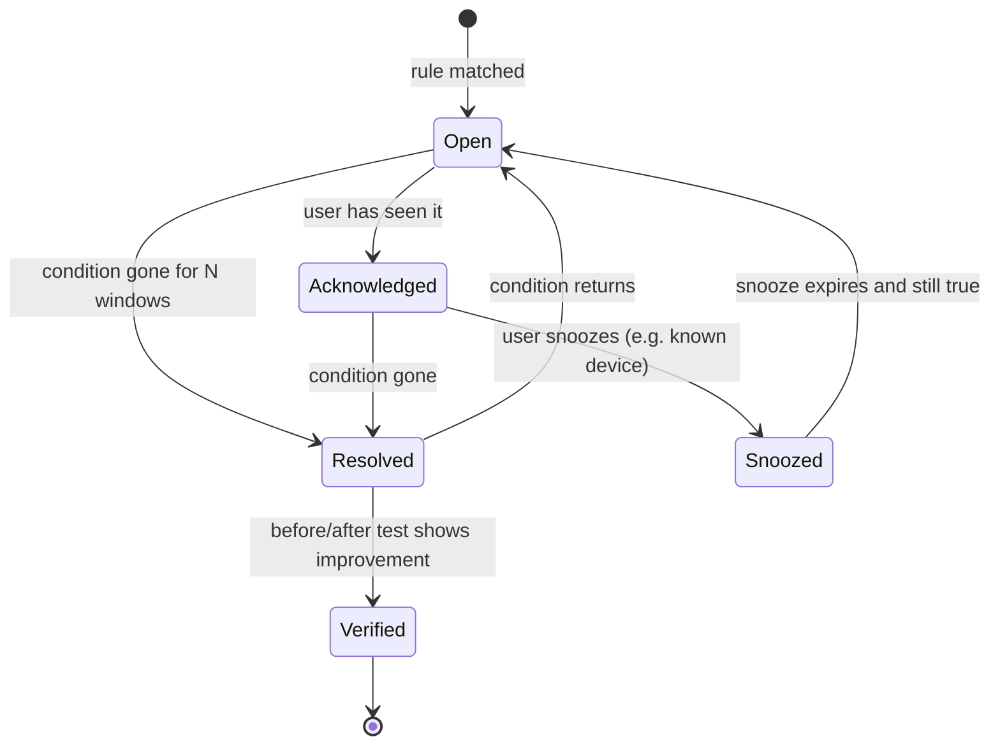

# Sequences and state machines

## 1. Starting the tray app



## 2. Probe auto-discovery and adoption



Probes that are already adopted are matched by id whatever IP they get, so DHCP changes and moves need no configuration.

## 3. Moving a probe (placement change)

```mermaid
sequenceDiagram
  actor U as User
  participant P as Probe
  participant E as Engine
  participant W as Web UI
  U->>P: unplug, carry to new room, power on
  P->>P: compare surroundings with last placement (joined unit, signal to units, neighbour set)
  alt surroundings changed a lot
    P->>P: screen: "Moved? Pick room" (rooms list synced from engine)
    U->>P: tap "Living room"
    P->>E: placement changed (room, time)
  else user changes it in the browser
    E->>W: "Probe C5 looks moved (joined Outdoor node, -78 dBm)"
    U->>W: set placement = "Living room"
    W->>E: set placement
    E->>P: POST /api/placement
  end
  E->>E: close old placement, open new one; later results tagged with it
```

## 4. Quick diagnosis ("it's laggy right now")

```mermaid
sequenceDiagram
  actor U as User
  participant W as Web UI
  participant E as Engine
  participant P as Probe in the problem room
  participant R as ASUS units
  U->>W: Quick diagnosis (room = Boys' room, device = Xbox)
  W->>E: start session (5 min)
  par probe
    E->>P: POST /api/test, then /api/air (joined channel, 60 s)
    P-->>E: latency, loss, DNS, air time by category, devices, broadcast sources
  and router
    E->>R: poll every 30 s: Xbox band/node/rate/RSSI/retries, radio utilisation all bands
  and PC
    E->>E: ping Xbox every 1 s, ping router/internet, DNS matrix
  and wire (if Npcap)
    E->>E: count broadcasts per source
  end
  E->>E: rules over the session window
  E->>W: findings ranked, with evidence charts
  W->>U: "Broadcast flood from Fingbox uses 27% of 2.4 GHz air. Xbox is on 2.4 GHz at -71 dBm via Outdoor node; it supports 5 GHz."
```

## 5. Evening monitor while the PC app may close



## 6. ASUS poll cycle

```mermaid
sequenceDiagram
  participant S as Scheduler
  participant A as ASUS collector
  participant R as BT8 (router)
  participant N as Nodes (BT8 1F, BD4 x3)
  participant DB as Store
  S->>A: every 60 s
  A->>R: web API: get_clientlist(), get_cfg_clientlist()
  R-->>A: clients with node, band, rssi, rates; nodes with backhaul
  A->>R: SSH: per-band station stats, utilisation, /proc/net/dev, new syslog lines
  loop each online node
    A->>N: SSH: per-band station stats, utilisation, backhaul link, counters
  end
  A->>A: parse with the unit's capability profile (wl / iw / iwpriv)
  A->>DB: station samples, radio samples, events (roam, deauth reason, DFS)
  Note over A,R: every 15 min also: settings diff, DHCP leases, topology
```

## 7. Probe lifecycle



## 8. Finding lifecycle


