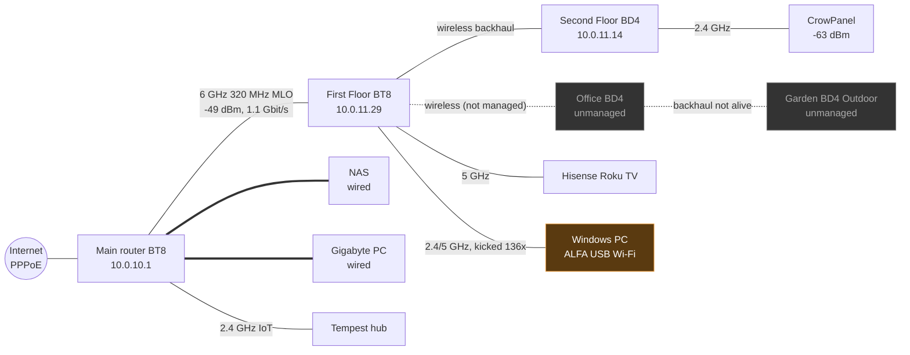

# Topology, device details, history and enrichment

How MeshLens shows *what is connected to what*, gives one-click access to a device's Wi-Fi details and handovers, keeps history, and lets the user add knowledge the network cannot provide.

## 1. Topology map

| ID | Requirement | Pri |
|---|---|---|
| MAP-01 | **Interactive topology map** in the web UI: Internet (WAN, ISP, public/CGNAT) → main router → mesh units (with **backhaul type**: wired, 6 GHz, MLO, 5 GHz, and its quality: signal, rate, errors) → switches / wired ports → devices. Wired and Wi-Fi links drawn differently; Wi-Fi links coloured by signal and labelled with band. | M |
| MAP-02 | Built from verified sources: `cfg_device_list`, per-node JSON (aliases, preferred parent), `relist.json` (backhaul MACs), `clientlist.json` / `allwclientlist.json` (device → unit, band, SSID), `wiredclientlist.json` and bridge FDB (wired device → unit/port), `diag_port_status.json` (port speeds), probes (placements), Pi-hole/HA (names). | M |
| MAP-03 | **Views:** by unit (mesh tree), by room (using probe placements and user rooms), by type (consoles, IoT...), by SSID/band, and "problems only" (devices with findings). | M |
| MAP-04 | **Live and historical:** the map shows now, and a time slider replays any moment in the retained history (e.g. "where was the gaming PC at 21:14 when it lagged?"). | S |
| MAP-05 | **Unmanaged / offline units** (e.g. Office, Garden today) shown greyed with the reason (not in mesh list, backhaul not alive, SSH unreachable). | M |
| MAP-06 | Export the map as an image (PNG/SVG) for reports. | S |

Example generated from the 13 November capture (simplified):

## 2. Quick access to a device's Wi-Fi details and handovers

| ID | Requirement | Pri |
|---|---|---|
| DTL-01 | **Device page** reachable from anywhere (map, lists, search by name/IP/MAC): identity (all names with sources, vendor, type, user notes), IP/MAC history, wired port or Wi-Fi connection now. | M |
| DTL-02 | **Wi-Fi panel**: unit, band, SSID, channel, security (WPA2/WPA3), signal (now, min/max today), tx/rx rate with MCS/NSS/width, retries/failures, idle, connected since, MLO links, roaming-assistant threshold that applies; sparkline of signal and rate over the last 24 h. | M |
| DTL-03 | **Handover / journey timeline**: every connect, disconnect, roam (from unit A to B, signals), kick (reason, signal), steering, with gaps; counts per day; ping results of watched devices overlaid. | M |
| DTL-04 | **Air view** (from probes): air time used, bytes, rate seen in the air, broadcasts it sends. | S |
| DTL-05 | **Network view**: open ports, services (mDNS/UPnP), DNS activity (Pi-hole), connections, data rates. | S |
| DTL-06 | **Findings** about the device and plain-English advice ("prefers 2.4 GHz although it supports 5 GHz; kicked 21 times today at -71 dBm on First Floor"). | M |
| DTL-07 | **Compare two devices** or the same device on two days. | C |

## 3. History

| ID | Requirement | Pri |
|---|---|---|
| HIS-01 | Everything collected is stored with timestamps: per-minute series (signal, rates, utilisation, throughput, latency, air), events (journeys, kicks, roams, WAN, inventory changes), snapshots (topology, settings, ports, services). | M |
| HIS-02 | **Retention:** raw and per-minute data for 1 month (D-20); **hourly and daily summaries for 12 months** (D-25), so long-term trends survive. | M |
| HIS-03 | **History explorer:** pick a time range and see the network as it was (map time slider, device timelines, charts, findings active then). | M |
| HIS-04 | **"What changed"** feed: new/gone devices, setting changes on the router, new ports/services, firmware updates, unit online/offline, with diffs. | M |
| HIS-05 | Export any range as JSONL/CSV, and as a report. | M |

## 4. Manual enrichment

| ID | Requirement | Pri |
|---|---|---|
| ENR-01 | Per device, the user can set: **name**, **owner** (person), **room/location**, **type**, **tags** (e.g. gaming, work, IoT, kids), **notes**, **importance** (watched / normal / ignore), and **known/trusted** state. | M |
| ENR-02 | **Expectations** that turn into checks: "should be wired", "should be on 5/6 GHz", "should be on the IoT SSID", "should always be online", "should never be online at night", "expected ports". Violations become findings. | M |
| ENR-03 | **Group devices** that are one physical thing with several MACs (e.g. phone with private addresses per SSID, MLO links, a PC with Ethernet + Wi-Fi). | M |
| ENR-04 | **People and rooms:** define people (owner of devices) and rooms (used by probe placements and the map); optional floor plan image with rooms drawn on it. | S |
| ENR-05 | User data always wins over detected data, but both are kept and shown ("name: Ollie's PC (you), DESKTOP-4HF2 (DHCP), ALFA Networks (vendor)"). | M |
| ENR-06 | **Bulk edit and import/export** (CSV/JSON), including import from `homelab-unified` device overrides and the ASUS client nicknames. | S |
| ENR-07 | Name suggestions from all sources (mDNS, DHCP, HA, ASUS nickname) that the user can accept with one click. | S |

## 5. More features worth adding (backlog)

| ID | Feature | Why | Pri |
|---|---|---|---|
| FX-01 | **Coverage map per room**: signal and air figures from probe placements on the floor plan; "weakest rooms". | Shows where a mesh unit or cable is needed. | S |
| FX-02 | **Roaming threshold simulator**: replay the logs with a different roaming-assistant RSSI (e.g. -75 instead of -70) and estimate how many kicks would not have happened. | Turns the -70 dBm finding into a concrete setting suggestion. | S |
| FX-03 | **Experiments (before/after)**: label a change ("IGMP snooping on", "Fingbox removed"), and MeshLens compares the same metrics for equal periods before and after. | Proves whether a change helped. | M |
| FX-04 | **Scheduled checks**: e.g. a monitor every evening 19:00-23:00 on watched devices and the boys' room probe. | Captures intermittent evening problems automatically. | M |
| FX-05 | **Gaming session view**: detect sessions from connections to known game/voice services (conntrack + DNS) and show lag, loss, kicks and air during each session. | Directly answers "was it laggy during that game?". | S |
| FX-06 | **Health scores**: per device, per unit, per room and overall, with the top reason. | One-glance status. | S |
| FX-07 | **ISP outage and speed log**: WAN drops, first-hop loss, speed tests over months (summaries). | Evidence for the ISP. | S |
| FX-08 | **Channel and placement advice**: from probe surveys and unit signals, suggest channel/width, node placement, wired backhaul candidates. | | C |
| FX-09 | **Home Assistant / MQTT export**: publish key sensors (health, latency, devices online) back to HA. | Fits the existing home automation. | C |
| FX-10 | **Device lifecycle**: "not seen for 30 days", duplicate names, devices that changed vendor; tidy-up suggestions. | Keeps the inventory clean. | C |
| FX-11 | **Bandwidth per device over time** (router per-client counters + Traffic Analyzer if enabled). | "Who used the internet when it was slow". | S |
| FX-12 | **Wi-Fi password-free guest/IoT audit**: which devices could move to the IoT SSID, and which SSIDs could be switched off to save air time. | Builds on SEC-01 and the air findings. | S |
